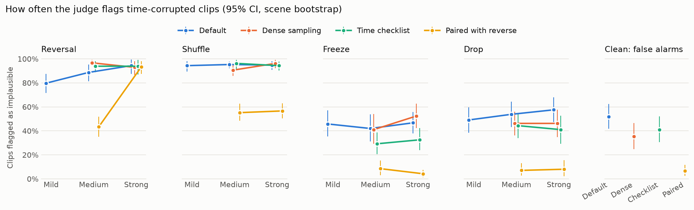

# Temporally Blind Judges?

**Stress-testing VLM judges of physical plausibility with time-only video corruptions.**

Video-generation benchmarks increasingly ask a vision-language model, often Gemini, whether a generated video is physically plausible. Many physical errors are errors in time: things happening in the wrong order, running backward, pausing or skipping. If the judge can't see time, its physics scores miss exactly those errors.

This project takes real videos where physics is correct by definition (Google DeepMind's [Physics-IQ](https://github.com/google-deepmind/physics-IQ-benchmark)) and corrupts them in ways that break **only time**: every frame the judge sees is a real frame, only the order changes. Because each corruption is made on purpose, the correct verdict is known without human labels.

**Research questions**

1. **Sensitivity:** how often does the judge catch each corruption, at each strength, and how often does it wrongly flag clean clips?
2. **Why it fails:** does denser frame sampling or an explicit time checklist change the result?
3. **A fix:** does showing the clip next to its reversed copy close the gap, and at what cost?
4. **Does it matter:** do the blind spots predict the judge's errors on real generated videos labelled by people? *(Not run yet.)*

---

## Results

Judge `gemini-3.8-flash` (static frame extraction, low media resolution, low thinking). **212 real clips from 37 irreversible Physics-IQ scenes**, 13 conditions per clip, 6 judging setups: 10,990 answers, $14.21 in API costs. Hypotheses were committed in [`HYPOTHESES.md`](HYPOTHESES.md) before any judge call; every decision since is dated in [`NOTEBOOK.md`](NOTEBOOK.md). Full tables: [`results/summary.md`](results/summary.md).



**Main findings**

1. **The judge catches errors in order and direction.** Full reversals and shuffles are flagged 94–95% of the time at default settings, far above the false-alarm rate. Every frame is real, so this requires comparing frames.
2. **At 1 frame/s it has no sensitivity to errors in speed.** Freezes and drops are flagged no more often than untouched clips; freezes slightly less often. At 4 frames/s a little sensitivity appears.
3. **It flags half of the untouched real clips** (52% at default), most often describing an object "teleporting": a fast event that happened between two sampled frames. Showing 4 frames/s or adding one sentence about the sampling to the prompt cuts false alarms by 17–22 points.
4. **It knows which way time runs when it can compare.** Shown a clip and its reversed copy, it picks the forward one 93% of the time (false alarms 7%).

**Detection minus false alarms**, in percentage points (2 × balanced accuracy − 1; 0 means the judge cannot tell corrupted from clean). Flag rates alone mislead here, because the false-alarm rate is high. 95% CIs from a cluster bootstrap over scenes are in `results/metrics.csv`.

| | Default (1 fps) | Dense (4 fps) | Told about sampling | Time checklist | Paired with reverse |
|---|---|---|---|---|---|
| Full reversal | +42 | +58 | +61 | +53 | **+87** |
| ½ reversal | +37 | +61 | +65 | +53 | +37 |
| Shuffle (medium / strong) | +43 / +43 | +55 / +61 | +67 / +66 | +55 / +53 | +49 / +50 |
| Freeze (medium / strong) | **−10** / −5 | +6 / **+17** | −1 / −3 | −12 / −8 | +2 / −2 |
| Drop (medium / strong) | +2 / +6 | **+11** / **+11** | +1 / +2 | +3 / 0 | 0 / +1 |
| *False alarms on clean clips* | *52%* | *35%* | *30%* | *41%* | *7%* |
| *Balanced accuracy, all corruptions* | *0.59* | *0.67* | *0.66* | *0.62* | *0.64* |

**Hypotheses** (committed in [`HYPOTHESES.md`](HYPOTHESES.md) before any judge call, each with a test stated in advance for when it is wrong)

| | Prediction (abridged) | Wrong if… | Result |
|---|---|---|---|
| H1 | At default, reversals and freezes are caught far less often than shuffles, because the judge relies on what single frames show; freeze misses owe more to 1 frame/s sampling than to the judge | reversals are caught about as often as shuffles | **Wrong.** Full reversals 94% vs shuffles 95%; over all strengths reversals trail by 7 points [3, 12], freezes by 50. At 4 fps freezes stay far below reversals (detection − false alarms +6 / +17 vs +58), so sampling explains only part of the freeze misses |
| H2 | Denser sampling helps short corruptions (freezes, drops) more than reversals, and freezes more than drops | reversals gain as much or more, or denser sampling doesn't help | **Wrong.** Detection gain at 4 fps: reversals +3 [0, +8], freezes +2 [−6, +10], drops −9 [−17, −3]. The second part holds: freezes gain 12 points [5, 19] more than drops |
| H3 | The checklist raises detection, and false alarms rise too, mostly with "jump or teleport" answers; at 4 fps they fall | false alarms rise by less than 5 points | **Wrong.** False alarms fall by 11 points [2, 20] and detection by 6 [2, 10]. The explanation holds: 76% of checklist false alarms include a "jump" answer, and at 4 fps they halve (41% → 20%) |
| H4 | Pairing with the reversed copy sharply improves reversal detection but not freezes or drops: the judge picks the clip that plays forward rather than "neither" | reversal detection rises by less than 20 points, or "neither" answers raise freeze and drop detection | **Wrong on reversals:** full reversal 93% vs 94% (default was already near the ceiling); ½ reversal 43% vs 89%, where both clips run partly backward and "neither" is rare. **Right on freezes and drops:** the forward clip is picked 92–96% of the time, "neither" never. What pairing changes is false alarms: 52% → 7% |
| H5 | Dense sampling helps more on clips whose main action lasts under 1 s | the gain is about the same for both groups, or larger for long actions | **Wrong.** Gain +1 [−6, +8] on 68 short-action clips vs −3 [−7, +2] on 144 long ones; difference +4 [−4, +12] |
| H6 | Partial reversals are caught more than the full reversal, because of the jumps at their edges | the full reversal is caught as often as the partial ones, or more | **Wrong.** At default the full reversal is caught most: ¼ reversal −15 points [−24, −6], ½ reversal −6 [−14, +2]; at 4 fps ½ vs full +4 [−1, +10] |

By their own tests, all six predictions failed, in the same direction: the judge handles the direction of time better than expected, and its weaknesses are speed and false alarms. Parts of the reasoning held (freezes gain more than drops from denser sampling; sparse sampling drives the checklist's false alarms; the paired judge picks the forward clip rather than "neither").

**Exploratory** (added after the pilot, before the main runs)

- **Telling the judge it sees one frame per second** cuts false alarms by 22 points [−30, −15] and raises balanced accuracy by 0.06 [0.03, 0.10]. But freeze and drop detection fall to the false-alarm rate: the flags it removes are the same "teleport" flags that made drops look detected at default.
- **Asked directly** (time checklist), the judge answers "backward motion: yes" for 43% of full reversals, and "pause: yes" for 3% of freezes, the same as for clean clips.
- **Stability:** the same question asked twice agrees 91% of the time (Cohen's κ 0.79, 390 pairs).

**Limitations**

- One judge model, at two frame rates (1 and 4 per second).
- Some corruptions land on near-still moments and are invisible even to a careful viewer. In a hand-labelled sample of 32 (one labeller), invisible shares were 0/12 freezes, 3/12 drops, 0/8 partial reversals. Invisible clips shrink detection-minus-false-alarms toward zero but cannot change its sign.
- Drops keep the clip length by holding the last frame; at 4 fps this can add up to about 7 points to strong-drop detection (16 of 212 clips have motion at the very end).
- Stated reasons are sorted by fixed keyword lists; a hand check against 50 labelled reasons is planned.
- Physics-IQ scenes are short tabletop experiments filmed in a lab.

---

## Quick start

```bash
git clone https://github.com/yanirattar/temporally-blind-judges.git && cd temporally-blind-judges
python -m venv .venv && source .venv/bin/activate        # Windows: .venv\Scripts\activate
pip install -e ".[dev]"

pytest                      # about a minute
tbj demo --fresh            # the whole pipeline on synthetic clips with a fake judge: free, about 3 minutes
```

The demo writes `demo/results/summary.md` and `demo/results/detection.png`. Its numbers come from a fake judge and mean nothing; they only prove the pipeline works on your machine.

For real runs you need a Gemini API key from [Google AI Studio](https://aistudio.google.com/apikey), on a paid tier (the free tier allows too few requests per day):

```bash
export GEMINI_API_KEY=...   # or put it in .env (git-ignored)
```

Set a budget alert in billing on day one. `config.yaml` also has a hard `budget_usd`: sync runs stop and batch submissions are refused past it.

ffmpeg is needed to encode clips. If it isn't on your PATH, the bundled `imageio-ffmpeg` binary is used.

---

## Workflow

Run every command from the repo folder.

| Step | Command | What happens | Your time |
|---|---|---|---|
| 1 | `tbj init` | Manifest of the 396 Physics-IQ videos, with a first-pass hint per scene | 1 min |
| 2 | `tbj download --set review` | One video per scene (66 files, 4K) | 15–40 min, unattended |
| 3 | `tbj review` | Writes `data/review/review.html`: each scene forward and reversed | 10 min to build |
| 4 | Open the page, label scenes, click **Download labels.csv** | You decide which scenes are irreversible | ~1.5 h |
| 5 | `tbj apply-labels ~/Downloads/labels.csv` | Labels every video of each scene | 1 min |
| 6 | `tbj download --set selected` | All 6 videos of each irreversible scene | unattended |
| 7 | `tbj build` | 13 conditions + reversed copies per clip, downscaled to 768 px | ~1 h, unattended |
| 8 | `tbj check` | `data/conditions/check.html`: clean vs corrupted side by side | 30 min to look |
| 8b | `tbj spots` | Screen for clips whose motion detection caught a side event (e.g. a reflection); lists clips to look at | ~5 min |
| 8c | `tbj check --visibility` | 32 freezes, drops and partial reversals to label visible / subtle / invisible in the page; download the CSV to `labels/visibility.csv` | ~45 min to label |
| 9 | `tbj plan pilot` then `tbj run pilot` | 20 clips × 4 conditions × 4 setups, 320 calls | ~1 h |
| 10 | `tbj batch submit main`, then `setups`, `consistency`, `checklist_dense` | The full run at half price | uploads 20–40 min, results within 24 h |
| 10b | `tbj run sampling_pilot`, then `tbj batch submit sampling` | Exploratory, added after the pilot: the sampling-aware prompt (80 live calls on the pilot clips, then by batch) | results within 24 h |
| 11 | `tbj batch status`, then `tbj batch collect` | Stores the answers | 1 min |
| 12 | `tbj analyze` | `results/summary.md`, `results/detection.png`, CSV tables | 1 min |

`tbj status` shows progress and spend at any time. Every command is safe to re-run: finished work is skipped, and identical clips are asked only once.

**Batch quota.** On Gemini's paid Tier 1, at most 3 million batch tokens can be queued or running at once per model. A larger submission stops with a 429 error; wait for jobs to finish and run the same command again: only the missing calls are sent.

**Labelling scenes (step 4).** Label a scene **irreversible** only if its reversed clip looks clearly impossible: spills un-spilling, dropped objects rising to where they were released, pieces reassembling. A rotating teapot or a ball rolling on a flat table looks fine backward, so it can't serve as ground truth. The hints from `tbj init` are guesses from the text descriptions; your eyes decide. This study labelled 37 of 66 scenes irreversible.

**Checking corruptions (step 8).** Each corrupted clip should look wrong next to its clean version. Exclude a clip (`exclude_videos` in `config.yaml`, then `tbj build`, which only rewrites `conditions.csv`) when its corruptions miss the event that makes the scene irreversible, and record why in `NOTEBOOK.md`.

---

## Cost

`tbj plan <name>` prints an estimate before anything runs. Actual cost of this study with `gemini-3.8-flash` ($0.75 in / $3.75 out per million tokens through Dec 31, 2026; half price in batch), 212 clips:

| Setup | Calls | Input tokens per call | Output + thinking per call | Cost |
|---|---|---|---|---|
| Default (main + consistency) | 3,192 | 730 | ~300 | $2.73 |
| Dense (4 fps) | 1,940 | 2,314 | ~340 | $3.05 |
| Time checklist | 1,940 | 821 | ~330 | $1.86 |
| Paired with reverse | 1,940 | 1,189 | ~930 | $4.35 |
| Told about sampling | 1,940 | 792 | ~350 | $1.91 |
| Checklist, 4 fps | 212 | 2,405 | ~300 | $0.31 |
| **Total** | **11,164** | | | **$14.21** |

Pilot calls (400) ran live at full price; everything else ran by batch. Thinking tokens are billed as output.

---

## How it works

### Corruptions

All corruptions are frame-index maps (`tbj/corrupt.py`): output frame *t* shows input frame `index[t]`. Every map keeps the clip length, so duration is never a cue.

| Corruption | Mild | Medium | Strong | What the judge sees |
|---|---|---|---|---|
| Reversal | middle 25% | middle 50% | whole clip | Part of the action plays backward |
| Shuffle | 2 segments | 4 segments | 8 segments | Scenes jump between moments; no segment keeps its original successor |
| Freeze | 0.25 s | 0.5 s | 1 s | Everything pauses mid-motion, then continues where it stopped |
| Drop | 0.1 s | 0.25 s | 0.5 s | Moving objects jump ahead |

Partial reversals, freezes and drops are placed inside the **motion span** (`tbj/motion.py`): the frames where the share of changed pixels is above 20% of its peak. Placement is random but reproducible (seeded by clip and condition). `conditions.csv` records where each corruption landed and how much of it overlaps the motion.

A useful property: the clean clip played backward is, frame for frame, the strong reversal. So in the paired setup, the clean and strong-reversal conditions show the judge the same two videos. A consistent judge picks the same one both times.

### Judging setups

| Setup | Kind | Prompt | Frames/s | Question |
|---|---|---|---|---|
| `default` | single | `default_v1` | 1 | Overall plausibility rubric; time is never mentioned |
| `dense` | single | `default_v1` | 4 | Same, with 4× the frames |
| `checklist` | checklist | `checklist_v1` | 1 | Explicit yes/no questions: backward motion, pauses, jumps, impossible order |
| `paired` | paired | `paired_v1` | 1 | The clip and its reversed copy, in random order: which one runs forward? |
| `checklist_dense` | checklist | `checklist_v1` | 4 | The checklist with 4× the frames, on clean clips (tests H3's explanation) |
| `sampling_aware` | single | `sampling_v1` | 1 | Exploratory, added after the pilot: the default prompt plus one paragraph saying the video is sampled once per second |

Each setup changes one thing relative to `default`, so differences can be attributed. Answers are JSON constrained by a schema (`tbj/judge.py`), with the one-line reason first. All calls use static frame extraction (frames at exactly the setup's rate, all placed in context, rather than Gemini's opt-in agentic mode that chooses what to watch), low media resolution (about 66 tokens per frame measured), low thinking, the model's default temperature and no audio.

**Flag** (clip judged implausible): verdict "implausible" for single and checklist setups; for paired, preferring the reversed copy or rejecting both. **Score** (for AUROC): (5 − plausibility score) / 4, or a confidence-weighted equivalent for paired. The checklist also gets a looser variant, `checklist_any`: flagged if any question is answered yes.

### Caching, batches and uploads

- Every call is stored in `runs/results.sqlite` under a key built from the clip bytes, the prompt text, the frame rate, the model settings and the repeat index. Re-running never pays twice; editing a prompt re-runs only the setups that use it; byte-identical clips are asked once.
- To change a prompt, add a new file (for example `tbj/prompts/default_v2.txt`) and point the setup at it. Old answers stay in the store, and `tbj analyze` only uses answers that match the current config.
- Clips are uploaded once per content hash through the Gemini Files API (`runs/uploads.json`). Uploads expire after about 48 hours; batch submissions re-upload anything with under 26 hours left.
- Sync runs retry rate limits and server errors with exponential backoff. Batch jobs that fail or expire return their requests to the queue.

### Statistics

`tbj analyze` reports, per setup and condition: detection rate, false-alarm rate on clean clips, balanced accuracy and AUROC, each with a 95% confidence interval from a **cluster bootstrap over scenes**. Clips of one scene are correlated, so whole scenes are resampled. It also reports each setup minus `default` on the same clips, agreement and Cohen's kappa between repeated runs, how often a flagged clip's stated reason is a time problem, and cost per setup.

Analyses written into the code before any judge call:
- **H5:** the gain from dense sampling on clips whose detected motion lasts under 1 s vs 1 s or more (medium and strong corruptions), and the difference between the two gains.
- **H6:** detection of the ¼ and ½ reversals against the full reversal, on the same clips, at default and dense settings. Partial reversals jump at both edges; the full reversal has no jumps, only direction.
- **Visibility (control):** a corruption on a near-still moment can be physically impossible yet invisible, and counts as a miss. `tbj check --visibility` shows a random sample of 32 freezes, drops and partial reversals to label by eye; `tbj analyze` reports the share labelled invisible per corruption with a 95% interval. Invisible corruptions can lower a detection rate by at most their share, so a gap larger than that bound cannot be explained by them. (An automatic pixel-based measure was tried first and dropped: it failed checks against the eye in both directions; `tbj spots` keeps it only as a screen for clips whose motion detection caught a side event.)

Added after the pilot, before the main runs (exploratory): the pilot's clean clips were flagged 45% of the time at default settings, mostly for objects "teleporting" during falls between two sampled frames. Two additions follow: the `sampling_aware` setup (does telling the judge how it sees the video cut false alarms, and at what cost in detection?), and stated-reason categories (fixed keyword lists: backward motion, jump or disappearance, pause, none), which show whether a corruption was caught for the right reason.

### Validation on generated videos (question 4, not run yet)

Put labelled videos (for example from ImplausiBench or FinePhyEval, if their licences allow) in a CSV with columns `path,label[,id]`, where `label` is `plausible` or `implausible`. Then:

```bash
tbj add-external validation.csv
tbj batch submit external        # later: tbj batch collect && tbj analyze
```

The summary gains a table of accuracy and Cohen's kappa against the human labels for each setup.

---

## Repo layout

```
config.yaml          every setting: paths, corruption strengths, model, setups, plans, prices, budget
HYPOTHESES.md        hypotheses, committed before any judge call
NOTEBOOK.md          dated decisions, checks, observations and runs
results/             summary.md, detection.png and CSV tables from this study
tbj/
  physiq.py          manifest, downloads, scene review page
  motion.py          motion span detection
  corrupt.py         the corruptions, as frame-index maps
  build.py           renders conditions; check and visibility pages; outside videos
  judge.py           prompts, JSON schemas, cache keys, request building, parsing, cost
  prompts/           versioned prompt files
  uploads.py         Gemini Files API uploads with expiry tracking
  store.py           SQLite store of every call and batch job
  plan.py            plans -> jobs
  runner.py          sync runner and Batch API runner
  spots.py           screen for clips whose motion detection caught a side event
  analyze.py         metrics, bootstrap CIs, figure, summary
  fake.py            fake Gemini client for the demo and tests
  synthetic.py       synthetic clips for the demo and tests
tests/               unit tests and an end-to-end test
```

Generated files (`data/`, `runs/`, `demo/`, `results/answers.csv`) are git-ignored.

## Notes

- Model: `gemini-3.8-flash`, pinned for the whole study. Changing `judge.model` starts a fresh set of answers.
- Physics-IQ videos are not redistributed here; `tbj download` fetches them from the benchmark's public bucket. Cite Physics-IQ as its repository asks.
- Excluded clips (see `NOTEBOOK.md`): marble-run-x 0103, 0104, 0105, 0301, 0302, where motion detection followed a reflection instead of the marble; and 0207, 0257, 0310, 0311, 0312, which are byte-identical copies of other Physics-IQ recordings.
- `tbj/resources/physiq_descriptions.csv` is copied from the Physics-IQ repository (Apache 2.0); see `tbj/resources/NOTICE.md`.
